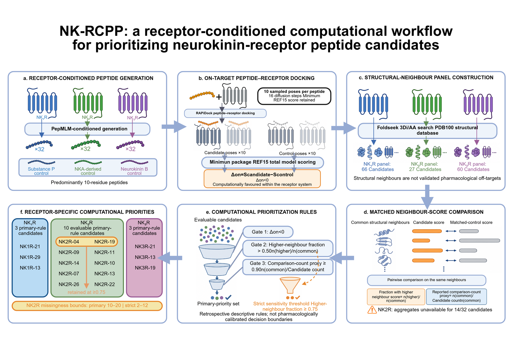

# NK-RCPP

**Neurokinin Receptor–Conditioned Peptide Prioritization**
*A retrospective, receptor-matched audit of 96 peptide candidates across NK1R, NK2R and NK3R*

[](https://www.python.org/)
[](https://pandas.pydata.org/)
[](LICENSE)
[](LICENSE)



---

## Scope

This repository is the archived dataset, code and figure sources behind NK-RCPP. It was designed as a
**retrospective, descriptive audit** of a fixed computational screening repository: it reanalyses archived
outputs and does **not** rerun peptide generation or docking. "NK-RCPP" denotes the reconstructed sequence of
receptor-conditioned generation, on-target docking, structural-neighbour aggregation and deterministic
prioritization — the name does not imply a new generation algorithm or experimental validation.

Read it with these three boundaries in mind:

* **No wet-lab data.** Nothing here shows that any prioritized peptide binds, activates or selectively engages
  a neurokinin receptor. The audit quantifies how a shortlist *changes* when matched evidence, missingness and
  decision thresholds are made explicit; it does not claim improved hit rates, affinity, agonism, selectivity
  or safety.
* **REF15 total model scores are not binding free energies.** They depend on the modelled complex, so
  comparisons are confined to candidates and their receptor-matched control *within the same receptor system*.
* **Structural neighbours are not validated pharmacological off-targets,** and the neighbour-score fraction is
  not a safety probability or a selectivity ratio. It is a computational stress test of score behaviour across
  matched contexts.

No p values were calculated for the receptor-specific audit — its thresholds are deterministic prioritization
rules, not hypothesis tests. Exploratory, uncorrected p values appear only for the external NK2R benchmark
(step 6).

## Headline results

| | NK1R | NK2R | NK3R |
|:--|--:|--:|--:|
| Candidates generated (PepMLM) | 32 | 32 | 32 |
| Receptor-matched control | Substance P | NKA-derived | Neurokinin B |
| Control REF15 total model score | 574.39 | 771.13 | 2240.54 |
| Candidates with Delta-on < 0 | **14/32** (43.8%) | **23/32** (71.9%) | **6/32** (18.8%) |
| Best candidate (score, Delta-on) | NK1R-18 (517.29, −57.10) | NK2R-27 (636.35, −134.78) | NK3R-21 (1965.25, −275.29) |
| Candidates with neighbour summaries | 32/32 | 18/32 | 32/32 |
| Structural-neighbour panel (Table S3 rows) | 66 | 27 | 60 |
| Members of the primary-rule shortlist | 3 | 10 | 3 |
| Members of the strict rule (≥ 0.75) | 0 | 2 | 0 |

Across the three receptors: **82 evaluable candidates** carried **4,518 matched structural-neighbour
comparisons**. **16 of the 33** evaluable on-target-favoured candidates survived the joint primary rule — a
**51.5% reduction** of that pool. At equal shortlist sizes the joint and on-target-only selections shared
**8/16** candidates, so **half of the selected identities changed** even when the testing budget was held
constant.

> **Primary rule** — Delta-on < 0 **and** neighbour-score fraction > 0.50 **and** reported comparison-count
> proxy ≥ 0.90, applied independently within each receptor.
> **Strict sensitivity rule** — same, with a fraction threshold of ≥ 0.75.
> **Legacy audit rule** — the first two criteria without the count proxy.

## Pipeline

| Step | Operation | Tool | Directory |
|:--|:--|:--|:--|
| 1 | Receptor-conditioned candidate generation — 32 peptides per receptor, mostly 10 residues, plus a receptor-matched control | PepMLM (authors' public Colab) | [`step1_peptide_generation/`](step1_peptide_generation/) |
| 2 | On-target docking — 10 poses per peptide, minimum REF15 total model score retained; Delta-on = candidate − receptor-matched control | RAPiDock + Rosetta REF15 | [`step2_positive_docking/`](step2_positive_docking/) |
| 3 | Structural-neighbour retrieval — combined 3Di/amino-acid search of PDB100, redundancy-reduced | Foldseek, CD-HIT 0.50 | [`step3_foldseek_search/`](step3_foldseek_search/) |
| 4 | Matched structural-neighbour docking — candidate *and* control docked against every panel member, so the comparison is paired | RAPiDock + REF15 | [`step4_negative_docking/`](step4_negative_docking/) |
| 5 | Aggregation and prioritization — neighbour-score fractions, count proxies, primary/strict rules, threshold grid, missingness bounds, shortlist intersections | Python (pandas/NumPy) | [`step5_analysis/`](step5_analysis/) |
| 6 | Exploratory external NK2R benchmark — 10 competition peptides, length-matched random controls, sequence-space projection | Python; archived ESM-2 + UMAP coordinates | [`step6_competition_benchmark/`](step6_competition_benchmark/) |

Figures use the manuscript's numbering ([`figures/README.md`](figures/README.md) maps every file to its
`Fig.`/`Supplementary Fig.` number and generating script).

## Repository layout

```
NK-RCPP/
├── step1_peptide_generation/   input/  receptor chains          output/ candidate tables + pseudo-perplexity
├── step2_positive_docking/     input/  receptor PDBs, RAPiDock CSVs   output/ long + wide REF15 scores
├── step3_foldseek_search/      output/ per-receptor PDB100 hits, alignments, panel FASTA
├── step4_negative_docking/     input/  per-batch docking CSVs   output/ per-complex neighbour scores
├── step5_analysis/output/      rankings, pairwise aggregates, per-pair deltas, UMAP coordinates
├── step6_competition_benchmark/output/ competition and length-control scores
├── figures/                    main/ supplementary/ tables/ (Fig. 1–5, S1–S9, TableS1–S4)
├── scripts/                    every script that produced the tables and figures
└── docs/                       manuscript guide, competition comparison, project status
```

## Results in the archive

### On-target scoring

The proportion of candidates with a better on-target docking score than their matched control was highest for
NK2R (23/32, 71.9%), followed by NK1R (14/32, 43.8%) and NK3R (6/32, 18.8%). The largest within-receptor
improvements were NK1R-18 (517.29 vs 574.39, Delta-on = −57.10), NK2R-27 (636.35 vs 771.13, Delta-on =
−134.78) and NK3R-21 (1965.25 vs 2240.54, Delta-on = −275.29). The NK1R comparison also paired 10-residue
candidates with 11-residue Substance P.

### Joint primary rule

Matched structural-neighbour summaries covered **82** candidates with **4,518** comparisons; the panels held
66 NK1R, 27 NK2R and 60 NK3R annotated rows, and every evaluable candidate had a reported count proxy of
**1.00**, so the ≥ 0.90 proxy criterion did not further distinguish them.

| Receptor | Primary-rule shortlist | Neighbour-score fraction | Delta-on |
|:--|:--|:--|--:|
| NK1R | NK1R-21, NK1R-29, NK1R-13 | 36/66, 35/66, 34/66 | −11.57, −29.80, −15.70 |
| NK2R | NK2R-04, NK2R-19, NK2R-14, NK2R-07, NK2R-26, NK2R-09, NK2R-11, NK2R-10, NK2R-13, NK2R-22 | NK2R-04 and NK2R-19: 21/27 (0.778) | −100.60, −72.21 |
| NK3R | NK3R-21, NK3R-13, NK3R-19 | 34/60, 34/60, 33/60 | −275.29, −55.26, −28.47 |

Only **NK2R-04** and **NK2R-19** also met the strict ≥ 0.75 threshold.

### Discordance between the two ranking dimensions

The on-target and structural-neighbour rankings captured different aspects of score behaviour and did not
select the same leading candidates:

| Candidate | On-target rank | Neighbour-score fraction | Outcome |
|:--|:--|:--|:--|
| NK1R-18 | best NK1R score (Delta-on −57.10) | 29/66 = 0.439 | fails the fraction criterion |
| NK2R-27 | best NK2R score (Delta-on −134.78) | 11/27 = 0.407 | fails the fraction criterion |
| NK1R-14 | Delta-on **+50.23** | 41/66 = 0.621 (highest qualified NK1R) | fails the on-target criterion |

The two endpoints therefore carry different information and are kept separate; their joint use reduces
dependence on a single score.

### Thresholds and missingness

* Raising the fraction cutoff from > 0.50 to **> 0.55 removed all NK1R candidates**.
* The strict **≥ 0.75** rule retained only the two NK2R candidates.
* These changes arise from discrete counts close to the boundary — candidates immediately above and below a
  cutoff are **neighbouring priorities, not distinct biological classes**.
* Structural-neighbour summaries were missing for **14 NK2R candidates**, 10 of which had Delta-on < 0. The
  unconstrained bounds are therefore **10–20 candidates under the primary rule** and **2–12 under the strict
  rule**. These bounds quantify dependence on unavailable evidence; they do not predict the missing outcomes.

### Sequence patterns

At a per-position frequency threshold of 0.30 the consensus strings were **SVPRQQCFGF** (NK1R),
**PKPRQCCFQR** (NK2R) and **DTPYQQSNGF** (NK3R). NK2R-02 contains 11 residues, so it was excluded from the
position-wise heatmaps (31 NK2R candidates) while remaining in the candidate inventory and raw on-target
analyses. These distributions describe the fixed generated sets and can guide diversity-aware experimental
sampling; without enrichment or replicate generation they **cannot be called receptor-binding motifs**.

### Exploratory NK2R benchmark (step 6)

| Endpoint | Competition peptides (n = 10) | Study NK2R candidates |
|:--|:--|:--|
| Length-adjusted z-score < 0 | 9/10 | 11/31 study 10-mers |
| Delta-on < 0 | 5/10 | — |
| Neighbour-score fraction > 0.50 | 8/10 | 14/18 evaluable |
| Joint rule | 3/10 (3/5 of the competition 9-mers) | 10/18 evaluable |

Score–potency agreement was uncertain (Spearman rho = +0.42, P = 0.23, n = 10). Exploratory two-sided
Mann-Whitney comparisons gave P = 0.2204 for raw scores (10 vs 32 peptides), P = 0.1699 for the
neighbour-score fraction (10 vs 18) and P = 5.09 × 10⁻⁴ for length-adjusted z-scores (10 vs 31). These
comparisons are **uncorrected for multiplicity**, involve different lengths, composition-specific baselines
and sampling frames, and do not establish superior binding or activity.

### Sequence space

The archived ESM-2 + UMAP projection contains **1,048** peptides: 949 leaderboard-only entries and 99 study
entries (96 candidates + 3 controls). Of these, 92 sequences of 7–10 residues formed a separated island and
956 sequences of 3–40 residues occupied the main projection; 4/10 competition peptides fell in the island.
The median distance to the nearest retained leaderboard entry was **0.04** for the 10 primary-rule NK2R
candidates and **0.07** for all 99 study entries. Distances are in arbitrary two-dimensional projection
units — they are not the original ESM-2 representation space and do not establish novelty, function or
receptor specificity.

## Terminology: manuscript ↔ archive

The manuscript renamed several archive fields for precision. When you read the CSVs, translate:

| Manuscript term | Archive column | Definition |
|:--|:--|:--|
| on-target score | `pos_score` | retained minimum REF15 total model score of the candidate against its own receptor |
| REF15 total model score | `best_score`, `rank1_score` | minimum available `ref2015score` for a modelled pair; not a binding free energy |
| Delta-on | `ΔPos` | `pos_score`(candidate) − `pos_score`(receptor-matched control); **< 0 is better** |
| fraction with a higher structural-neighbour score | `frac_safer` | `n_safer_delta_pos / n_common` |
| count of higher-scoring neighbours | `n_safer_delta_pos` | comparisons where the candidate score exceeded the control score |
| shared comparisons | `n_common` | structural neighbours scored for both candidate and control |
| mean matched score difference | `delta_mean` (legacy: `ΔNeg`) | mean candidate − control over the shared neighbours |
| reported comparison-count proxy | *derived* | `n_common / (number of Table S3 rows for that receptor)` |
| pass of the primary-rule first criterion | `better_binding` | legacy boolean: `ΔPos < 0` |
| pass of the primary-rule second criterion | `safer` | legacy boolean: `frac_safer > 0.50` |
| pass of the legacy audit rule | `both` | `better_binding and safer` (count proxy added only in the primary rule) |
| structural neighbours | TableS3 rows | Foldseek-retrieved comparison structures, **not** validated off-targets |

## Data conventions and traps

* **The step-4 NK2R batch labels are not the canonical candidate codes.** `nk2r_neg_inputs/peptide01…18`
  map to the NK2R-01/03/04/07/09/10/11/13/14/19/22/23/24/26/27/28/30/32 subset, and `peptide19` is the
  **control**. NK1R and NK3R do line up (`peptideNN` = `NK1R-NN` / `NK3R-NN`, control = `known`). Always join
  on **sequence**, never on the batch label — `scripts/paired_neighbour_deltas.py` does exactly that.
* **`legacy audit rule` vs `primary rule`.** The count proxy is applied only in the primary rule; the legacy
  rule is the first two criteria alone. The two agree on this archive because every evaluable candidate has
  proxy 1.00.
* **`rank1` vs `best_score`.** All downstream analysis uses `rank1` (the pose RAPiDock ranked first);
  `best_score` (minimum over the 10 poses) is shipped so the two choices can be compared.
* **`COMP_TOP10_negative_docking_input.STALE-offby-one.csv`** is kept on purpose. The merged competition input
  file carries pre-fix labels that are shifted by one relative to the per-batch inputs, so looking a peptide's
  sequence up by complex name there silently returns its neighbour. The per-batch files under
  `comp_top10_neg_inputs/` win; `scripts/harvest_docking_scores.py` warns on disagreements.
* **NK2R pseudo-perplexity is empty.** The NK2R Colab export was not archived, so those sequences were
  recovered from the docking input. The native generator ranking could not be reconstructed for any receptor.
* **Nothing compares raw REF15 scores across receptors** — the absolute value depends on the modelled system.

## Note on evidence level

The package the manuscript audited was aggregate-only: pair-level structural-neighbour score rows were absent,
so the candidate-level aggregates had to be treated as inherited results. **This archive is richer than that
package** — step 4 ships the underlying per-complex REF15 scores. Running

```bash
python scripts/paired_neighbour_deltas.py --repo .
```

rebuilds the pair-level comparison behind every aggregate from the raw numbers and reproduces the shipped
counts exactly:

```
[ok] 4518 pair-level comparisons over 82 candidates
[check] NK1R: 32 candidates compared, 0 disagree with the shipped aggregates
[check] NK2R: 18 candidates compared, 0 disagree with the shipped aggregates
[check] NK3R: 32 candidates compared, 0 disagree with the shipped aggregates
```

So all 4,518 comparisons / 82 candidates quoted in the manuscript are reproducible from this repository, not
just inherited. What remains unreconstructable here is what was absent from the original archive: the raw
RAPiDock pose directories, the original generation outputs and the pair-level rows for the COMP/length-control
campaigns.

## Reproducing

```bash
# Audit arithmetic (Python 3.12; pandas 3.0.1 / NumPy 2.3.5 used in the manuscript)
python scripts/paired_neighbour_deltas.py --repo .     # 4,518 pair-level comparisons over 82 candidates
python scripts/make_candidate_tables.py --repo .       # step 1 candidate tables
python scripts/harvest_docking_scores.py --repo .      # step 2 / 4 / 6 score tables from raw run folders
python scripts/harvest_foldseek_hits.py --repo .       # step 3 condensed neighbour panels
python scripts/make_peptide_codes.py --repo .          # TableS1
```

Docking itself is **not** re-run by any of these; the RAPiDock configuration used for it is documented in
[`step2_positive_docking/README.md`](step2_positive_docking/README.md) (`N = 10`, `inference_steps` /
`actual_steps = 16`, `ref2015`, local checkpoint `rapidock_local.pt`, `conformation_partial = 1:1:1`,
`batch_size = 4`) together with the GPU runner scripts under `scripts/`.

Figure regeneration is listed in [`figures/README.md`](figures/README.md).

## Limitations

One archived dataset; retrospective, uncalibrated score thresholds; no wet-lab validation. Native PepMLM
rankings and activity data for the 96 candidates were unavailable, so shortlist compression cannot establish
improved hit rates or binder retention. Missing generation settings, raw poses, pair-level neighbour scores
and chemical-preparation records limit reproduction and assessment of terminal modifications, disulfides and
panel composition. The 10-peptide benchmark and its 5 composition-specific random controls per length provide
context, not independent pharmacological validation. Independent threshold calibration, orthogonal structural
assessment and equally sized prospective binding and functional comparisons are the next tests.

## Citing

If you use this archive, please cite the NK-RCPP manuscript (citation block to be filled in on publication)
and the tools it builds on: PepMLM ([Chen et al., *Nat. Biotechnol.* 2026](https://doi.org/10.1038/s41587-025-02761-2)),
RAPiDock ([Zhao et al., *Nat. Mach. Intell.* 2025](https://doi.org/10.1038/s42256-025-01077-9)),
Rosetta REF15 ([Alford et al., *JCTC* 2017](https://doi.org/10.1021/acs.jctc.7b00125)),
Foldseek ([van Kempen et al., *Nat. Biotechnol.* 2024](https://doi.org/10.1038/s41587-023-01773-0)),
CD-HIT ([Li & Godzik, *Bioinformatics* 2006](https://doi.org/10.1093/bioinformatics/btl158)),
ESM-2 ([Lin et al., *Science* 2023](https://doi.org/10.1126/science.ade2574)) and
UMAP ([McInnes et al., *JOSS* 2018](https://doi.org/10.21105/joss.00861)).

## Licence

Code under the MIT licence; data, tables and figures under CC BY 4.0 — see [`LICENSE`](LICENSE).
The NK2R receptor model derives from an AlphaFold2 prediction; see
[`docs/ALPHAFOLD_TERMS_OF_USE.md`](docs/ALPHAFOLD_TERMS_OF_USE.md).

Figure styling follows the conventions of
[ChenLiu-1996/figures4papers](https://github.com/ChenLiu-1996/figures4papers).

---

<sub>中文版说明见 [`README.zh-CN.md`](README.zh-CN.md)。</sub>
